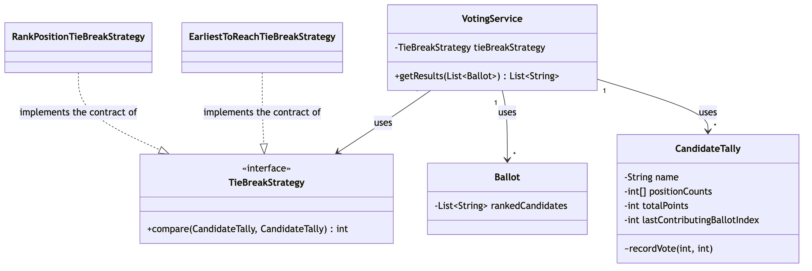
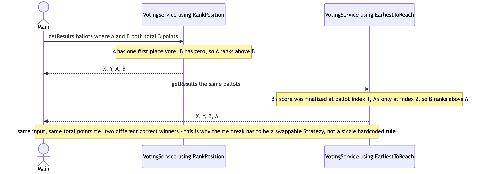

# Session 09 — Voting Algorithm (LLD/OOD) · 2.2/10

> This session chose the right pattern and wired it the right way — a `TieBreakerStrategy`
> interface, injected into `ResultService` through its constructor, with two implementations —
> which is further than Sessions 07 and 08 got. But the strategy field was `static`, so
> constructing a second `ResultService` silently rewired every existing instance's behavior; the
> ballot-processing loop crashes on any ballot with fewer than 3 candidates, even though the
> problem explicitly allows that; and Strategy 1 was left as an acknowledged `// TODO` stub that
> falls back to alphabetical order on every tie. No diagram was produced.

**Problem:** Process a list of ballots and return every candidate sorted by total points
descending (1st place = 3pts, 2nd = 2pts, 3rd = 1pt); on a tie, support two different, swappable
tie-break strategies · **Focus:** class design, no architecture/scale concerns · **Overall:**
2.2/10 · **Weakest areas:** Implementation & Exceptions, Class Diagram & Relationships,
Correctness · **Artifacts:**
[`Main.java`](../src/main/java/com/shubham/app/votingalgorithm/practice/Main.java),
[entity/](../src/main/java/com/shubham/app/votingalgorithm/practice/entity/),
[service/](../src/main/java/com/shubham/app/votingalgorithm/practice/service/),
[README.md](../src/main/java/com/shubham/app/votingalgorithm/practice/README.md) (the problem
statement — no class diagram was produced for this mock)

## The problem

> Process a list of ballots, and return all candidates sorted in descending order by their total
> number of points. A voter is allowed to vote for up to three different candidates. The first
> vote that a voter places is worth three points, the second two, the third one.
>
> Follow-up: how to handle candidates with the same points? Two strategies were proposed —
> (1) whoever reached the tied total first; (2) compare 1st-place vote counts, then 2nd, then 3rd.

What it really tests: whether a Strategy interface that's *correctly shaped and correctly wired*
can still have its entire purpose defeated by how its state is held — plus whether "up to three"
in the problem statement was actually read as a real constraint on ballot size, not just as a cap.

## Requirements & entities gathered

No separate requirements/entities document was written for this mock, beyond the verified problem
statement itself. What was produced is the entity list the code actually contains:

- `TieBreakerStrategy` (interface) — correct shape, one method.
- `CountPlaceViseStrategy`, `FirstScorerStrategy` — the two implementations; the latter is an
  acknowledged stub (`// TODO : fix this`).
- `ResultService` — the only other class. No `exception/` package exists at all — zero custom
  exceptions anywhere in this mock.

Gaps against [step ① and ②](../concepts/answer-framework.md#-requirements--scope) of the
framework: two real domain concepts — a ballot, and a candidate's accumulated tally — were never
modeled as entities at all. A ballot is a raw `List<String>` with no validation; a candidate's
state is a raw `int[]` with no names for its three slots, handed directly out of `ResultService`'s
internal map to whichever `TieBreakerStrategy` is called.

## The design produced

No diagram — as-drawn or otherwise — exists anywhere under
[`src/main/java/com/shubham/app/votingalgorithm/practice/`](../src/main/java/com/shubham/app/votingalgorithm/practice)
for this mock — the third session in a row with this exact gap.

What the code's actual (undrawn) relationships are:
- `CountPlaceViseStrategy`/`FirstScorerStrategy` — implement the contract of `TieBreakerStrategy`.
- `ResultService` — uses a `TieBreakerStrategy`, assigned to a field shared by every instance (see
  lost-point #1).

## Scorecard

| Axis | Score | Note |
|---|---|---|
| Requirements & Entities | 3/10 | Two real domain concepts (a ballot, a candidate's tally) were never modeled as entities — raw `List<String>`/`int[]` instead. |
| Class Diagram & Relationships | 1/10 | No diagram produced at all — the third session running with this exact gap. |
| Pattern Choice & Justification | 4/10 | The furthest any session has gotten: a correctly-shaped Strategy, actually wired via constructor injection with two real implementations — but a `static` field defeats the whole point of per-instance swappability. |
| Implementation & Exception Handling | 1/10 | Zero custom exceptions anywhere; a hardcoded `for (i=0;i<3;i++)` loop crashes on any ballot shorter than 3; the `static` field bug; duplicated `calculatePoints` logic in both strategy classes. |
| Correctness (Primary-Flow Walkthrough) | 2/10 | The one demoed path (3-candidate ballots, no tie) is correct, but neither tie-break strategy, nor a short ballot, nor the static-field bug was ever exercised. |
| **Overall** | **2.2/10** | ❌ Needs work |

## What lost points — and the fix

| What I missed | The senior answer | Study link |
|---|---|---|
| `ResultService.java:13,16` — `tieBreakerStrategy` is `static`, assigned in a non-static constructor. Constructing a second `ResultService` with a different strategy silently rewrites the behavior of every existing instance. Verified: a `ResultService` built with `CountPlaceViseStrategy` correctly ranked one candidate first, then — after an unrelated second `ResultService` was constructed elsewhere with `FirstScorerStrategy` — the *same, untouched* first instance started producing `FirstScorerStrategy`'s ordering instead. | A plain `final` instance field, set once in the constructor — see `ideal/VotingService`. | [`concepts/answer-framework.md`](../concepts/answer-framework.md) ④ Pattern Choice & Justification |
| `ResultService.java:23-24` — `for (int i = 0; i < 3; i++) { ballot.get(i); }` crashes with `IndexOutOfBoundsException` on any ballot with fewer than 3 names, even though the problem explicitly allows a voter to rank "up to three" candidates. Verified by running `[["A"],["B"]]` directly. | Loop over `ballot.getRankedCandidates().size()`, not a hardcoded `3` — see `ideal/Ballot`/`VotingService`. | [`concepts/answer-framework.md`](../concepts/answer-framework.md) ⑥ Exception Handling |
| `FirstScorerStrategy.java:18` — `// TODO : fix this`, falls back to alphabetical order on every tie. The real blocker: the `int[] vote` data it receives (a position-count summary) has no timestamp information at all, so "who reached the total first" can't be answered from it — the data pipeline, not just this method, needed to change. | Track `lastContributingBallotIndex` per candidate while processing ballots — see `ideal/CandidateTally`/`EarliestToReachTieBreakStrategy`. | [`concepts/answer-framework.md`](../concepts/answer-framework.md) ⑤ Core Classes/Interfaces |
| No `exception/` package at all — a null ballots list, a ballot with 0 or 4+ names, a blank candidate name, or the same candidate ranked twice on one ballot all pass through unvalidated (or crash, per the row above). | `InvalidBallotException`/`InvalidVotingConfigException`, thrown at construction — see `ideal/`. | [`concepts/answer-framework.md`](../concepts/answer-framework.md) ⑥ Exception Handling |
| `CountPlaceViseStrategy.java:7-9` and `FirstScorerStrategy.java:7-9` — the identical `calculatePoints` method is duplicated verbatim in both sibling Strategy implementations. | The base "sort by total points" rule is fixed by the problem statement, not something that varies — it belongs in `VotingService` itself, not duplicated inside every Strategy — see `ideal/VotingService`'s comparator. | [`concepts/answer-framework.md`](../concepts/answer-framework.md) ④ Pattern Choice & Justification |
| `ResultService.java:34` — `Collections.sort(teams, (a, b) -> {...})` uses a lambda. | Anonymous `Comparator` class, per this repo's established convention. | — |

## What went well

- `CountPlaceViseStrategy`'s actual comparison logic — once reached — is correct: total points,
  then 1st-place count, then 2nd, then 3rd, then alphabetical, exactly matching the problem's
  Strategy 2 description.
- The `TieBreakerStrategy` interface is genuinely wired into `ResultService` via constructor
  injection, with two real implementations — the furthest any session so far has gotten with the
  shape *and* the wiring of a Strategy pattern, even though the `static` bug undermines it.
- The incomplete `FirstScorerStrategy` was marked with an honest `// TODO`, not shipped silently
  broken — the gap was signaled in the code itself, not hidden.

---

## The ideal design

> **Implemented** in
> [`src/main/java/com/shubham/app/votingalgorithm/ideal/`](../src/main/java/com/shubham/app/votingalgorithm/ideal)
> — see that package's own
> [`README.md`](../src/main/java/com/shubham/app/votingalgorithm/ideal/README.md) for the full
> write-up.

**Framing sentence:** a correctly-chosen Strategy pattern can still be completely defeated by
*how its state is held* — a `static` field is a global, not an instance field, no matter how
correct the interface shape and the constructor injection around it look.

The rest of this section follows [`concepts/answer-framework.md`](../concepts/answer-framework.md)'s
8 steps in order; see `ideal/README.md` for the complete version. Summary:

### ① Functional Requirements & Scope

`getResults(ballots)` returns every candidate sorted by total points descending, with a swappable
`TieBreakStrategy` for ties. Out of scope: streaming/incremental results (the source says the
winner is declared only after all votes are in), concurrency.

### ② Core Entities & Responsibilities

`Ballot`, `CandidateTally`, `TieBreakStrategy` (interface), `RankPositionTieBreakStrategy`,
`EarliestToReachTieBreakStrategy`, `VotingService`. See `ideal/README.md` for the full table.

### ③ Relationships & Class Diagram

Source at
[`diagrams/session09-ideal-class-diagram.mmd`](diagrams/session09-ideal-class-diagram.mmd).

### ④ Pattern Choice & Justification

**Pattern used: Strategy** (`TieBreakStrategy`) — this doesn't fix a missing pattern, it fixes a
correctly-chosen one that was broken by a `static` field. See `ideal/README.md` ④ for the full
justification, including why the base "most points wins" rule was pulled out of the Strategy
entirely (it's fixed by the problem statement, not something that varies).

### ⑤ Core Classes/Interfaces

See `ideal/README.md` ⑤ for signatures. `CandidateTally.recordVote` is package-private — only
`VotingService` mutates it, the same convention as `Connection.occupy()`/`free()` in the
connection-pool `ideal/` design.

### ⑥ Exception Handling

`InvalidBallotException`, `InvalidVotingConfigException` — see `ideal/README.md` ⑥.

### ⑦ Primary-Flow Walkthrough — the actual fix for this session's bug

Source at
[`diagrams/session09-ideal-sequence-diagram.mmd`](diagrams/session09-ideal-sequence-diagram.mmd).

With `ballots = [[X,B,Y], [X,Y,B], [A,X,Y]]`, A and B both total 3 points.
`RankPositionTieBreakStrategy` ranks A above B (A has 1 first-place vote, B has 0);
`EarliestToReachTieBreakStrategy` ranks B above A (B's score was locked in at ballot index 1, A's
only at index 2). Both are correct under their own rule — proof the Strategy here is load-bearing,
not cosmetic. This is also the actual fix for `FirstScorerStrategy`'s `// TODO`:
`CandidateTally.lastContributingBallotIndex` is the one piece of data the practice code's `int[]`
summary never captured. `VotingServiceTest#theTwoTieBreakStrategiesCanDisagreeOnTheSameInput` and
`VotingServiceTest#twoVotingServiceInstancesWithDifferentStrategiesDoNotInterfereWithEachOther`
are the regression tests.

### ⑧ Concurrency & Extensibility

**Concurrency:** explicitly out of scope — the problem never raises it.

**Extensibility:** a new tie-break rule → one new `TieBreakStrategy` implementation, zero changes
to `VotingService` — directly answering the problem's own "Open-Closed Principle" follow-up
framing.

## Takeaways to drill

1. `static` on a field that's assigned inside a non-static constructor is almost always a bug, not
   a style choice — it means every instance shares one slot, so the "latest-constructed wins"
   behavior silently defeats whatever per-instance configuration the constructor looked like it
   was setting up. Grep for this shape specifically: a `static` field + a constructor that writes
   to it.
2. "Up to N" in a problem statement is a real constraint on valid input sizes, not just an upper
   bound to code defensively against — a loop that assumes the maximum is always present will
   crash on the valid-but-smaller cases the phrase was there to allow for.
3. When a tie-break strategy is stuck on a `// TODO`, check whether the blocker is really inside
   that one method, or whether the *data being handed to it* is missing the one piece of
   information the rule actually needs — here, no amount of rewriting `FirstScorerStrategy` alone
   could have worked without `ResultService` tracking ballot-index history in the first place.
4. The base, non-negotiable part of a sorting rule (here: "most points wins") doesn't belong
   inside a Strategy whose entire point is the part that *varies* — duplicating it into every
   Strategy implementation is a sign it was pulled into the wrong class.

> Rehearse this against [`concepts/answer-framework.md`](../concepts/answer-framework.md) before
> the next mock.

## How to Improve

Before calling a Strategy pattern "done," check how its instance is held just as carefully as
whether the interface shape is right — a `static` field is the single most common way a correctly
designed Strategy gets quietly defeated, and it's a one-line, easy-to-miss root cause.
