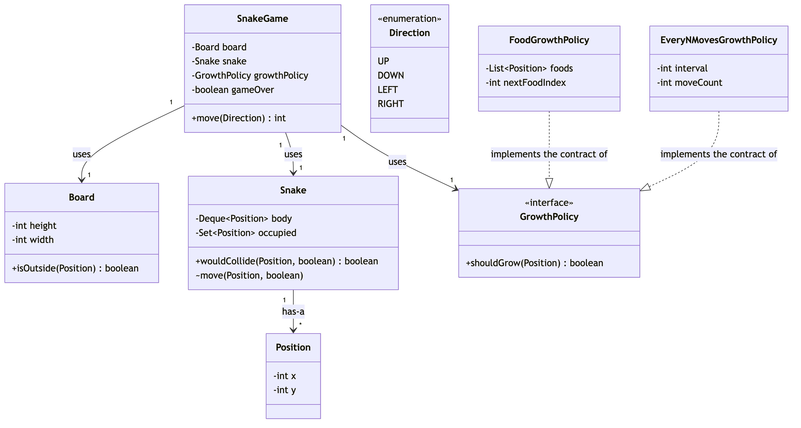

# Session 10 — Design Snake Game (LLD/OOD) · 2.0/10

> This session correctly solved the standard LeetCode 353 variant (growth on food) and reproduced
> its own official example exactly — the core deque + grid mechanic is right. But two real bugs
> were never exercised by the one demoed path: a self-collision check that runs *before* knowing
> whether the tail is about to vacate wrongly ends the game on a legal reversal, and a missing
> `gameOver` flag means a losing move can be silently "undone" by just calling `move` again. No
> diagram was produced, and no abstraction exists for the reported Atlassian variant (growth every
> 5 moves) that this problem's own source names as a follow-up — the user explicitly scoped this
> mock to the standard food-growth variant only.

**Problem:** Design a Snake game on a 2D board — `move(direction)` advances the snake, returns the
score or `-1` on game over (out of bounds or self-collision); standard variant grows on food,
reported Atlassian variant grows every 5 moves · **Focus:** class design, no architecture/scale
concerns · **Overall:** 2.0/10 · **Weakest areas:** Class Diagram & Relationships, Pattern Choice,
Implementation & Exceptions, Correctness · **Artifacts:**
[`Main.java`](../src/main/java/com/shubham/app/snakegame/practice/Main.java),
[entity/](../src/main/java/com/shubham/app/snakegame/practice/entity/),
[service/](../src/main/java/com/shubham/app/snakegame/practice/service/),
[README.md](../src/main/java/com/shubham/app/snakegame/practice/README.md) (the problem statement
— no class diagram was produced for this mock)

## The problem

> Design a Snake game played on a 2D board. The snake moves one cell per call in one of four
> directions; `move` returns the current score, or `-1` if the move ends the game (out of bounds,
> or the snake collides with itself).
>
> Standard (LeetCode 353): the snake grows by one cell when its head lands on the next food
> position, in the order the food list was given.
>
> Reported Atlassian variant: the snake grows by one cell every 5 moves, regardless of food.

What it really tests, for this mock specifically (scoped to the standard variant only): whether
the self-collision check correctly accounts for the one cell that's *about to stop* being
occupied — the snake's own tail, on any move that doesn't grow it — and whether "the game is over"
is actually a durable fact once reached, not just the return value of one call.

## Requirements & entities gathered

No separate requirements/entities document was written for this mock, beyond the verified problem
statement itself. What was produced is the entity list the code actually contains: `Position`
(record), `Direction` (enum), `Board` (height, width, **and** a food list), `Snake` (deque +
`boolean[][]` grid), `SnakeGame`.

Gaps against [step ① and ②](../concepts/answer-framework.md#-requirements--scope) of the
framework: `Board` holds `foods`, a concept that only exists for the standard variant — the
reported Atlassian variant has no food at all. Putting it on `Board` (shared by any future
variant) rather than somewhere specific to the food-growth rule is a modeling choice that would
need to be undone the moment a second variant was attempted.

## The design produced

No diagram — as-drawn or otherwise — exists anywhere under
[`src/main/java/com/shubham/app/snakegame/practice/`](../src/main/java/com/shubham/app/snakegame/practice)
for this mock — the fourth session in a row with this exact gap.

What the code's actual (undrawn) relationships are:
- `SnakeGame` — has-a `Board`, has-a `Snake`.
- `Snake` — has-a `Deque<Position>`, has-a a `boolean[][]` grid sized from `Board`'s dimensions at
  construction time (a real coupling — see lost-point #3).

## Scorecard

| Axis | Score | Note |
|---|---|---|
| Requirements & Entities | 4/10 | Entities are reasonably split, but `Board` owns `foods`, a concept specific to one growth rule, not every variant. |
| Class Diagram & Relationships | 1/10 | No diagram produced at all — the fourth session running with this exact gap. |
| Pattern Choice & Justification | 1/10 | No pattern or abstraction for growth at all — hardcoded directly into `SnakeGame.move`, despite the problem's own source naming a second growth variant as a follow-up. |
| Implementation & Exception Handling | 2/10 | Zero custom exceptions; a self-collision check that doesn't account for the tail vacating; a missing `gameOver` flag that lets a lost game resume; `Board`'s full public setters; `Snake.isOccupied` with no bounds-safety of its own. |
| Correctness (Primary-Flow Walkthrough) | 2/10 | The one demoed path (LeetCode's own official example) is exactly correct, but the tail-reversal case and the post-game-over continuation — both realistic, likely scenarios — were never exercised. |
| **Overall** | **2.0/10** | ❌ Needs work |

## What lost points — and the fix

| What I missed | The senior answer | Study link |
|---|---|---|
| `Snake.java:29-31` (`isOccupied`) checks the grid *before* the move's tail-pop happens, with no way to know whether this move grows the snake. Verified: a length-2 snake reversing onto its own current tail cell (no food this move) is wrongly reported as a collision and ends the game. | `Snake.wouldCollide(nextPosition, grow)` — told whether this move grows the snake, excludes the current tail from the collision check only when it doesn't. See `ideal/Snake`. | [`concepts/answer-framework.md`](../concepts/answer-framework.md) ⑤ Core Classes/Interfaces |
| `SnakeGame.java` has no `gameOver` field. A losing move never mutates `snake` (it returns `-1` immediately), so calling `move` again afterward resumes play from the pre-collision state as if the loss never happened. Verified: `move(UP)` out of bounds returns `-1`, then `move(RIGHT)` returns `0` — the game silently continued. | An explicit `boolean gameOver` field, checked first in `move` and set on any losing move. See `ideal/SnakeGame`. | [`concepts/answer-framework.md`](../concepts/answer-framework.md) ⑥ Exception Handling |
| `Snake`'s occupancy grid (`boolean[][]`) is sized from `Board`'s dimensions at construction time, and `Board.setHeight`/`setWidth` (`Board.java:21-30`) could change those dimensions afterward with nothing keeping the two in sync. | `Set<Position>` instead of a dimension-sized array — no board dimensions to desync from in the first place. See `ideal/Snake`. | [`concepts/answer-framework.md`](../concepts/answer-framework.md) ② Core Entities & Responsibilities |
| No pattern/abstraction exists for "when does the snake grow?" — hardcoded directly as a food-position check inside `SnakeGame.move`, even though the problem's own source names a structurally different growth rule (every 5 moves) as a reported follow-up. | `GrowthPolicy` Strategy — `FoodGrowthPolicy` and `EveryNMovesGrowthPolicy`, both plugged into the same `SnakeGame` with zero changes to it. See `ideal/README.md` ④. | [`concepts/answer-framework.md`](../concepts/answer-framework.md) ④ Pattern Choice & Justification |
| No `exception/` package at all — a non-positive board height/width, or a null `foods` list (which would NPE inside `isFoodPosition`), both pass through unvalidated. | `InvalidBoardConfigException`/`InvalidGrowthConfigException`, thrown at construction. See `ideal/`. | [`concepts/answer-framework.md`](../concepts/answer-framework.md) ⑥ Exception Handling |
| `SnakeGame.java:3-4` — `import ...entity.Board;` immediately followed by `import ...entity.*;`, which already covers it. | Drop the redundant explicit import. | — |

## What went well

- `Position` as a record and `Direction` as an enum carrying its own `(dx, dy)` vector are both
  clean, idiomatic choices — no notes.
- The core deque-plus-grid growth mechanic is correct for the variant it was built for, verified
  by reproducing LeetCode 353's own official example 1 exactly: `[0, 0, 1, 1, 2, -1]`.
- `isFoodPosition`'s `if (board.getFoods().size() <= indexToEat) return false;` guard against
  running past the end of the food list is a deliberate, thought-through defensive check, not an
  accident.

---

## The ideal design

> **Implemented** in
> [`src/main/java/com/shubham/app/snakegame/ideal/`](../src/main/java/com/shubham/app/snakegame/ideal)
> — see that package's own
> [`README.md`](../src/main/java/com/shubham/app/snakegame/ideal/README.md) for the full write-up.

**Framing sentence:** everything about validating a move (boundary, self-collision) is identical
between the standard and reported variants — only *whether this move grows the snake* differs, so
that's the one thing that needs to be a Strategy.

The rest of this section follows [`concepts/answer-framework.md`](../concepts/answer-framework.md)'s
8 steps in order; see `ideal/README.md` for the complete version. Summary:

### ① Functional Requirements & Scope

`move(direction)` returns the score or `-1`. Growth is a swappable `GrowthPolicy`: food-based
(standard) or every-5-moves (reported variant). Out of scope: concurrency (never raised by the
problem).

### ② Core Entities & Responsibilities

`Position`, `Direction`, `Board` (dimensions only — no food), `Snake`, `GrowthPolicy` (interface),
`FoodGrowthPolicy`, `EveryNMovesGrowthPolicy`, `SnakeGame`. See `ideal/README.md` for the full
table.

### ③ Relationships & Class Diagram

Source at
[`diagrams/session10-ideal-class-diagram.mmd`](diagrams/session10-ideal-class-diagram.mmd).

### ④ Pattern Choice & Justification

**Pattern used: Strategy** (`GrowthPolicy`) — fixes the complete absence of any growth
abstraction in the practice code. See `ideal/README.md` ④ for the full justification, including
why `foods` moved off `Board` and onto `FoodGrowthPolicy` specifically.

### ⑤ Core Classes/Interfaces

See `ideal/README.md` ⑤ for signatures. `Snake` uses a `Set<Position>` instead of a
dimension-sized `boolean[][]`, removing its coupling to `Board`'s dimensions entirely.

### ⑥ Exception Handling

`InvalidBoardConfigException`, `InvalidGrowthConfigException` — see `ideal/README.md` ⑥.

### ⑦ Primary-Flow Walkthrough — the actual fix for this session's bug

Source at
[`diagrams/session10-ideal-sequence-diagram.mmd`](diagrams/session10-ideal-sequence-diagram.mmd).

A length-2 snake reverses directly onto its own current tail cell. The practice code's collision
check ran before knowing the tail would vacate, so it wrongly ended the game; here,
`Snake.wouldCollide(nextPosition, grow)` excludes the current tail specifically when the move
doesn't grow the snake. Verified: the reversal now correctly continues the game.
`SnakeGameTest#reversingOntoTheVacatingTailIsLegal` and
`SnakeGameTest#theGameStaysOverAfterALosingMove` (the second, independently-found bug — no
`gameOver` flag) are the regression tests.

### ⑧ Concurrency & Extensibility

**Concurrency:** explicitly out of scope — the problem never raises it.

**Extensibility:** a new growth rule → one new `GrowthPolicy` implementation, zero changes to
`SnakeGame` — proven, not just claimed, by `EveryNMovesGrowthPolicy` plugging into the exact same
`SnakeGame` constructor the standard variant uses.

## Takeaways to drill

1. A collision/validity check that depends on *what else happens this same move* (here: whether
   the tail vacates) has to be computed in an order where that information is already known —
   checking occupancy before deciding growth, then growth after, silently bakes in the wrong
   answer for the one case where they interact.
2. "The game is over" needs to be a fact the object remembers, not just a return value from one
   call — if a losing move doesn't mutate state, nothing stops a later call from resuming play as
   if the loss never happened.
3. A field that's shared by every variant of a problem (here: `Board`) shouldn't hold a concept
   that only one variant actually has (here: `foods`) — the moment a second variant is attempted,
   that's the field that has to move.
4. When a class's own correctness depends on another object's state never changing after
   construction (here: `Snake`'s grid depending on `Board`'s dimensions staying fixed), check
   whether a different data structure removes the dependency entirely rather than just trusting
   the caller not to break it.

> Rehearse this against [`concepts/answer-framework.md`](../concepts/answer-framework.md) before
> the next mock.

## How to Improve

Before calling a game-like state machine "done," explicitly test what happens *after* a losing
move — call the mutating method again and confirm it's still refused. This session's two real
bugs (the tail-reversal collision and the post-game-over continuation) are both the kind that
never show up in a single straight-line demo, only in exactly the follow-up call a real player
(or a grading harness) would actually make.
