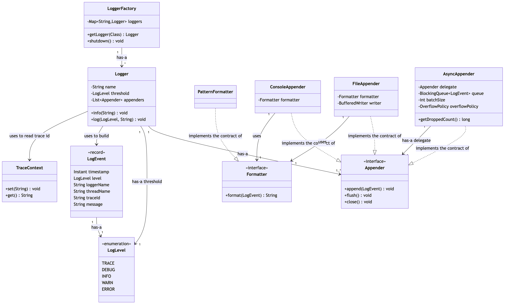
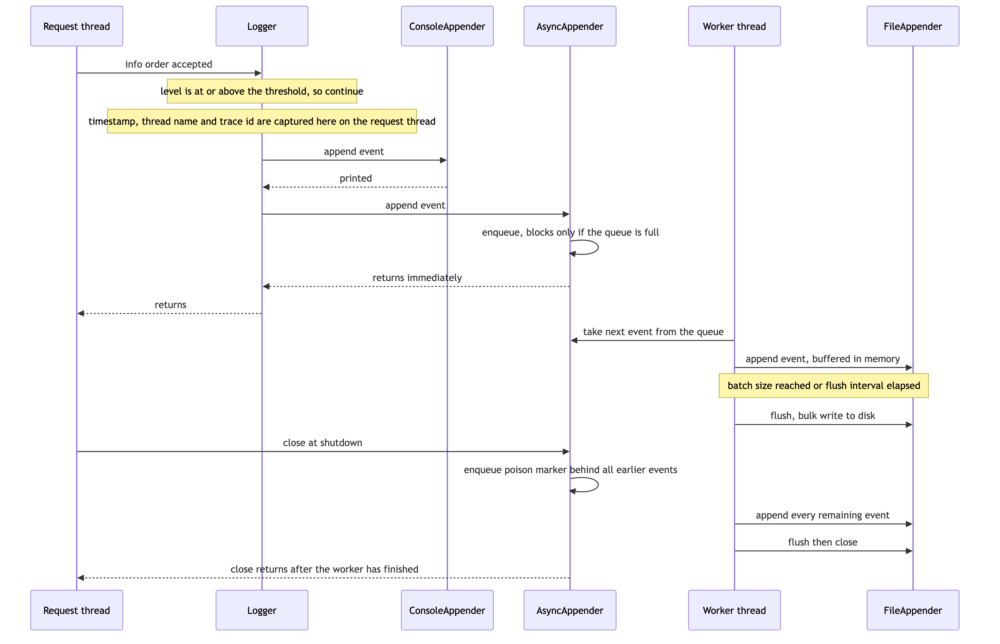

# Session 12 — Logging Library (LLD/OOD) · 2.8/10

> A real interview round at Enterpret, not a timed mock. The README carried the strongest thinking of any recent
> session — correct log fields, a producer/consumer split, and a genuinely good argument for one shared buffer
> over a buffer per consumer, with the "logs lost on crash" drawback named unprompted. The code did not follow
> it: what exists is a synchronous level filter that calls `System.out`, with one appender, no class name, no
> thread, no trace id and no queue or buffer at all. There was no class diagram, and the README's consumer-side
> design has a flaw it never caught — it looks up the trace id from the thread id *in the consumer*, which in an
> async design is the wrong thread. Here the written design is clearly ahead of the code, which is the opposite
> of the usual pattern in this tracker, where the code tends to run ahead of the writing.

**Problem:** Write a simple logging library with configurable outputs (file, console, external provider) and a
log-level limit, where each log line shows timestamp, level and class name · **Focus:** class design + concurrency,
no architecture/scale concerns · **Overall:** 2.8/10 · **Weakest areas:** Class Diagram & Relationships,
Implementation & Exception Handling · **Artifacts:**
[`README.md`](../src/main/java/com/shubham/app/logging/interview/README.md),
[`Main.java`](../src/main/java/com/shubham/app/logging/Main.java),
[entity/](../src/main/java/com/shubham/app/logging/interview/entity/),
[service/LogService.java](../src/main/java/com/shubham/app/logging/interview/service/LogService.java)

## The problem

> - Simple logging library with different configurable outputs (appenders): file, console, external log provider
>   such as New Relic, Datadog or Splunk.
> - Set the log level limit.
> - Each log shows the current timestamp, the level, and the class name.
>
> **Follow-ups asked in the round:** what fields a log line carries; how to optimise the file appender; what is
> the drawback of buffering.

The prompt is reconstructed from the attempt's own README, not quoted from the interviewer.

What it really tests: whether the *destination* is separated from the *act of logging* (so a new destination is
a new class, not an edit), and whether the candidate notices the logger sits on the application's hot path — so
writing to a slow destination must not make every caller wait, which is the whole reason for the queue and the
buffer.

## Requirements & entities gathered

What was produced: a written functional-requirements list (appenders, level limit, timestamp, level, class name),
an entity list (`LogLevel`, `CustomLogger`, `LogService`), a log-field answer (timestamp, level, message, class,
trace id), and an "Improvements: async write" note. No out-of-scope list and no actor.

Gaps against [step ① and ②](../concepts/answer-framework.md#-requirements--scope) of the framework: no
out-of-scope list (rotation, structured output, per-appender levels, shutdown behaviour all unaddressed), no
one-sentence responsibility per entity, and `CustomLogger` is listed as "Console appender, file appender, external
agent" in the README but is named like the thing a user calls, not like a destination.

## The design produced

No class diagram was produced. The code has three relationships:

- `LogService` — has-a `LogLevel` (the threshold) and has-a `CustomLogger` (exactly one).
- `ConsoleAppender` — implements the contract of `CustomLogger`.
- `CustomLogger` — uses `LogLevel` in its one method.

The README describes a much larger system (producer → queues per class → a consumer per queue → one shared buffer
→ bulk file write) that has no corresponding classes, so there was nothing to draw it from.

## Scorecard

| Axis | Score /10 | Note |
|---|---|---|
| Requirements & Entities | 5/10 | Requirements and the log-field list were written down and were sensible; no out-of-scope list, no responsibility sentences, and the entity list stopped at three while the README's design needed about eight. |
| Class Diagram & Relationships | 1/10 | None produced, for the sixth session running. |
| Pattern Choice & Justification | 4/10 | Strategy for destinations was the right instinct (`CustomLogger`), and the single-buffer argument is real design reasoning, but neither was named as a pattern or justified as a choice, and the queue-per-class idea is questionable. |
| Implementation & Exception Handling | 2/10 | Did not compile when first checked (leftover `org.example` imports from an IntelliJ template); one appender, `System.out` only, no validation, no exceptions, dead code. |
| Correctness (Primary-Flow Walkthrough) | 2/10 | The one path that exists (filter then print) works, but the designed flow was never walked, and the consumer-side trace-id lookup would have produced wrong output if it had been built. |
| **Overall** | **2.8/10** | Scored on both artifacts together: the README is the stronger half, the code the weaker. |

## What lost points — and the fix

| What I missed | The senior answer | Study link |
|---|---|---|
| `logging/README.md:46-47` — "from thread-id we can know thread name, traceId and request context details", done in the *consumer*. In the async design the consumer is a worker thread, so a thread-id lookup there returns the worker, not the caller. | Capture every caller-dependent field (timestamp, thread name, trace id) when the event is created, on the caller's thread, and carry them in the event. The consumer only formats and writes. | [`concepts/answer-framework.md`](../concepts/answer-framework.md#-primary-flow-walkthrough) |
| `logging/README.md:63` — the architecture has a queue and a consumer per class. A destination fed by many queues has no defined order, and a thread per class does not scale to hundreds of classes. | One queue and one worker per *destination*: arrival order is preserved and the thread count tracks the number of destinations, not classes. The README's own single-buffer argument already points here. | [`concepts/concurrency-primitives.md`](../concepts/concurrency-primitives.md) |
| `logging/service/LogService.java:43-51` — `printMessage(level, message)` is the whole library. The designed queue, buffer, flush policy and second appender have no code, and the demo never reaches them. | Build the thinnest slice of the *designed* flow first (event → queue → worker → buffered file), not the slice that is easiest to type. A README that out-designs the code is a plan, not an answer. | [`concepts/answer-framework.md`](../concepts/answer-framework.md#-core-classesinterfaces) |
| `logging/service/LogService.java:13` — exactly one `CustomLogger`, so "configurable outputs" (plural, in the requirement) cannot be expressed. | Hold a list of appenders and fan an event out to all of them, with a failing one isolated from the rest. | [`concepts/answer-framework.md`](../concepts/answer-framework.md#-concurrency--extensibility) |
| `logging/entity/ConsoleAppender.java:12-13` — layout is hardcoded inside the appender, via two separate `print` calls, and every line carries the debug text "Message from Console appender :". Two threads can interleave the halves. | Separate layout from destination (`Formatter`), and write one fully built string in one call. | [`concepts/design-principles.md`](../concepts/design-principles.md) |
| `logging/service/LogService.java:14` — `LOGGER_SLF4J` is a `java.util.logging.Logger`, mislabelled, and never used. `LogLevel.java:6` has a package-private `id` that duplicates what `Enum.compareTo` already gives. | Delete dead code before showing it; use the enum's own ordering. | [`concepts/design-principles.md`](../concepts/design-principles.md) |
| `Main.java` and `LogService.java` (as first checked) imported `org.example.*`, so the build failed for the whole repo. | Compile and run the demo once before calling a design finished. Fixed by the author on request. | [`CLAUDE.md`](../CLAUDE.md) (Common commands) |

## What went well

- The README's log-field answer (timestamp, level, message, class, trace id) is exactly what interviewers expect,
  and it was given before being asked.
- **The single-buffer reasoning is real design reasoning, not just a decision**: a buffer per consumer
  wastes memory when load is uneven, and per-class buffers produce out-of-order output when flushed. It names a
  trade-off, picks a side and gives the reason.
- The flush policy ("capacity full *or* fixed interval, whichever comes first") is the correct, standard answer.
- The drawback question was answered correctly and without prompting: logs still in the buffer are lost if the
  process dies. This is the one follow-up where nothing needed adding beyond the mitigations (shutdown hook,
  flush on error), which are listed in step ⑧ below.
- `CustomLogger` as an interface with `ConsoleAppender` as the first implementation is the right shape, even
  though it was never named as Strategy.
- The level check (`logLevel.getId() < level.getId()`) filters correctly, and the demo's two calls show a DEBUG
  message dropped under an INFO threshold.

---

## The ideal design

> **Implemented** in [`src/main/java/com/shubham/app/logging/ideal/`](../src/main/java/com/shubham/app/logging/ideal)
> — see that package's own [`README.md`](../src/main/java/com/shubham/app/logging/ideal/README.md) for what
> changed vs. this doc and why.

**Framing sentence:** a logger is called on the application's hot path, so the crux is separating the cheap,
caller-dependent part (build an immutable event, capturing the thread and trace id *now*) from the slow,
destination-dependent part (format and write), and letting an async hand-off decouple the two without losing or
reordering events.

The rest of this section follows [`concepts/answer-framework.md`](../concepts/answer-framework.md)'s 8 steps in
order.

### ① Functional Requirements & Scope

**Actors:** application code (calls the logger) and an operator (configures level and destinations at start-up).

**Operations:**
- Obtain a logger named after a class.
- Log at `TRACE`, `DEBUG`, `INFO`, `WARN` or `ERROR`; messages below the configured threshold are dropped.
- Every line carries timestamp, level, thread name, optional trace id, class name and message.
- Write to one or more destinations (console, file; external providers are further `Appender` implementations).
- Optionally make any destination asynchronous, with a bounded queue and a batch-or-interval flush.
- Shut down cleanly, draining and flushing everything queued.

**Explicitly out of scope:** log rotation and retention, structured (JSON) output, per-appender levels, runtime
reconfiguration, parameterised messages (`{}` placeholders), exception stack traces, and the network protocol of an
external provider.

### ② Core Entities & Responsibilities

| Entity | Responsibility |
|---|---|
| `LogLevel` | Names the five severities and decides whether one passes a threshold. |
| `LogEvent` | Immutable snapshot of one log call, with every caller-dependent field already captured. |
| `Logger` | Filters by level, builds the event on the caller's thread and fans it out to the appenders. |
| `LoggerFactory` | Hands out one logger per name and closes the appenders at shutdown. |
| `Appender` (interface) | **The varying concept** — where a finished event goes. |
| `Formatter` (interface) | Turns an event into text, so layout is independent of destination. |
| `ConsoleAppender`, `FileAppender` | Write a formatted event to the console or to a buffered file. |
| `AsyncAppender` | Decorates any appender with a bounded queue, one worker thread and a flush policy. |
| `TraceContext` | Holds the current thread's trace id for the logger to read. |
| `InvalidLoggingConfigException` | Thrown for an invalid configuration. |

### ③ Relationships & Class Diagram

- **Implements the contract of** — `ConsoleAppender`, `FileAppender` and `AsyncAppender` implement the contract of
  `Appender`; `PatternFormatter` implements the contract of `Formatter`.
- **Has-a** — `Logger` has-a threshold `LogLevel` and one or more `Appender`s; `LoggerFactory` has-a set of
  `Logger`s; `AsyncAppender` has-a delegate `Appender` and a queue of events; `LogEvent` has-a `LogLevel`.
- **Uses** — `ConsoleAppender` and `FileAppender` use a `Formatter`; `Logger` uses `TraceContext` to read the trace
  id and uses `LogEvent` to carry what it read.
- **Is-a** — deliberately absent; every variation is an interface implementation, not inheritance.

**Ideal class diagram:** source at
[`diagrams/session12-ideal-class-diagram.mmd`](diagrams/session12-ideal-class-diagram.mmd).



### ④ Pattern Choice & Justification

**Pattern used: Strategy, with Decorator.**

Strategy means a new destination or layout is one new class, not an edit to the logger. Decorator means
asynchronous delivery is a wrapper any appender can opt into, instead of a flag every appender must reimplement.

- **Strategy — destination:** `Appender` with `ConsoleAppender`, `FileAppender` (and, later, a provider client).
- **Strategy — layout:** `Formatter` with `PatternFormatter`; a JSON formatter is one new class.
- **Decorator — asynchrony:** `AsyncAppender` implements `Appender` and wraps an `Appender`, so it composes with
  any of them and with itself being absent.
- **Considered and rejected — Chain of Responsibility:** the repo's `loggingsystem` package uses it to route a
  message to the one handler for its level. Here every appender receives every event that passes the threshold,
  so a chain's "first handler wins" behaviour is the wrong fit; a plain loop is.

### ⑤ Core Classes/Interfaces

Signatures only — full implementations are in
[`src/main/java/com/shubham/app/logging/ideal/`](../src/main/java/com/shubham/app/logging/ideal), and tests proving
each class's behavior are in
[`src/test/java/com/shubham/app/logging/ideal/`](../src/test/java/com/shubham/app/logging/ideal) (`LoggerTest`,
`PatternFormatterTest`, `FileAppenderTest`, `AsyncAppenderTest`, `LoggerFactoryTest`):

```java
enum LogLevel { TRACE, DEBUG, INFO, WARN, ERROR; boolean isEnabledFor(LogLevel threshold); }

record LogEvent(Instant timestamp, LogLevel level, String loggerName,
                String threadName, String traceId, String message) {}

interface Appender  { void append(LogEvent e); default void flush() {} default void close() {} }
interface Formatter { String format(LogEvent e); }

class Logger {
    Logger(String name, LogLevel threshold, List<Appender> appenders);
    void trace(String m); void debug(String m); void info(String m); void warn(String m); void error(String m);
    void log(LogLevel level, String message);
    boolean isEnabled(LogLevel level);
}

class LoggerFactory {
    LoggerFactory(LogLevel threshold, List<Appender> appenders);   // requires a threshold and 1+ non-null appenders
    Logger getLogger(Class<?> owner);
    Logger getLogger(String name);
    void shutdown();                                               // closes (and so drains) every appender
}

class ConsoleAppender implements Appender { ConsoleAppender(Formatter f); }
class FileAppender    implements Appender { FileAppender(Path file, Formatter f); }   // buffered; flush() writes to disk
class AsyncAppender   implements Appender {
    AsyncAppender(Appender delegate, int queueCapacity, int batchSize,
                  Duration flushInterval, OverflowPolicy overflowPolicy);
    long getDroppedCount();
}
enum OverflowPolicy { BLOCK, DROP_NEWEST }
final class TraceContext { static void set(String id); static String get(); static void clear(); }
```

### ⑥ Exception Handling

- `InvalidLoggingConfigException` — thrown by `LoggerFactory` for a missing threshold or an empty/null-containing
  appender list, and by `AsyncAppender` for a non-positive capacity, batch size or interval, or a missing delegate
  or policy.
- `UncheckedIOException` — thrown by `FileAppender` when the file cannot be opened or written.
- **Edge case handled without an exception:** an appender that throws while handling an event is reported on
  `System.err` and skipped — the application call and the other appenders are unaffected. A logging failure is
  never allowed to become an application failure.
- **Edge case handled without an exception:** events offered after `close()`, or beyond capacity under
  `DROP_NEWEST`, are counted in `getDroppedCount()` and discarded.
- **Edge case handled without an exception:** a message below the threshold returns immediately, before an event
  is even built.

### ⑦ Primary-Flow Walkthrough — the actual fix for this session's bug

Source at
[`diagrams/session12-ideal-sequence-diagram.mmd`](diagrams/session12-ideal-sequence-diagram.mmd).



The fix for the attempt's real design bug is in the second note: the event is built — thread name and trace id
included — on the request thread, inside `Logger.log`, before anything crosses to the worker. The worker only
formats and writes, so it can never report its own thread or a missing trace id.
[`LoggerTest#traceIdIsReadFromTheCallingThreadAndIsNullWhenUnset`](../src/test/java/com/shubham/app/logging/ideal/entity/LoggerTest.java)
covers the capture, and
[`AsyncAppenderTest#closeDeliversEveryQueuedEventInOrderThenClosesTheDelegate`](../src/test/java/com/shubham/app/logging/ideal/service/AsyncAppenderTest.java)
covers the shutdown half of the flow.

### ⑧ Concurrency & Extensibility

**Concurrency:**
- Producers only touch a bounded `ArrayBlockingQueue`; one worker thread per `AsyncAppender` is the only thing that
  ever calls the delegate, so the delegate needs no locking of its own and events keep arrival order. A queue
  per class would give up exactly that ordering.
- `FileAppender` methods are `synchronized` because it can also be used synchronously from several threads.
- `Logger` is stateless after construction and `LoggerFactory` uses a `ConcurrentHashMap`, so both are safe to share.
- Shutdown enqueues a marker *behind* every earlier event, then joins the worker, so everything queued before
  `close()` is delivered, flushed and closed — no interrupts, which would also corrupt an in-flight file write.
- `AsyncAppenderTest#concurrentProducersLoseNothingAndKeepEachThreadsOwnOrder` fires 8 threads × 500 events at a
  queue of 16 (so producers genuinely block) and asserts all 4000 arrive and each thread's events stay in order.
  `AsyncAppenderTest#dropNewestCountsEventsThatDoNotFitInsteadOfBlocking` pins the overflow behaviour exactly.
- **Remaining risk:** events still queued when the process is killed instead of shut down are lost — the answer
  to the interview's "what is the drawback" question. Mitigations: call `shutdown()` from a JVM shutdown hook,
  flush synchronously for `ERROR`, and shrink `flushInterval` where loss matters more than throughput.

**Extensibility:**
- A new destination (Datadog, Splunk) → one new `Appender`, zero changes to `Logger`.
- A new layout (JSON) → one new `Formatter`.
- Per-appender levels → one new `Appender` decorator that filters before delegating.
- Rotation → one new `Appender` that wraps `FileAppender`s.

## Takeaways to drill

1. Capture caller-dependent data (thread, trace id, time) when the event is *created*, never in the consumer — an
   async hand-off changes which thread you are on.
2. Put one queue and one worker in front of each *slow destination*, not each source: ordering and thread count
   both follow from that.
3. Decide and state what happens when the queue is full (block or drop). An unbounded queue is not an answer, it
   is a deferred out-of-memory error.
4. Separate *layout* from *destination*; building one string and writing it in one call also avoids interleaved
   output.
5. A logging failure must never become an application failure — isolate each appender.
6. "What is the drawback" has a complete answer: say what is lost (queued events on a hard kill), then give the
   mitigations (shutdown hook, synchronous flush on `ERROR`, shorter interval).
7. A README that out-designs the code is a plan. Build the thinnest slice of the *designed* flow first.
8. Compile and run the demo before presenting it.

> Rehearse this against [`concepts/answer-framework.md`](../concepts/answer-framework.md) before the next mock;
> next move: re-solve a bounded-queue problem (Thread-safe Bounded Blocking Queue / Producer-Consumer from
> `TODO.md`) and state the full-queue policy before writing any code.

## How to Improve

Write the code for the flow you *designed*, in the order it runs, and stop adding design prose until the first
end-to-end path (call → event → queue → worker → file) executes. This round had strong written reasoning and a
weak match between that reasoning and the code, which is the cheapest gap to close: one thin vertical slice would have exposed the trace-id-on-the-wrong-thread flaw before the interviewer
did.
